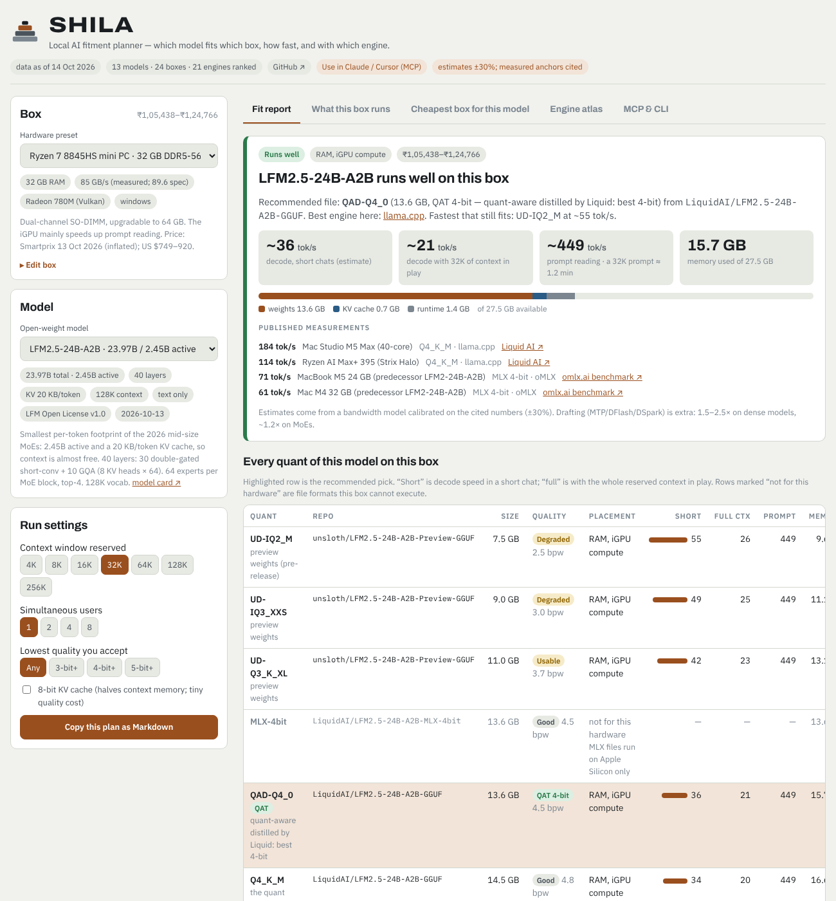

# SHILA

**Which open-weight LLM fits which machine, how fast it will run, and which inference engine to use — from a Raspberry Pi to a DGX Spark.**

[**Open the planner →**](https://arvidkarthik2000-hue.github.io/shila/) · [MCP server](#use-it-from-claude-cursor-or-any-mcp-client) · [CLI](#command-line) · [How the estimates work](#how-the-estimates-work) · [Contribute a benchmark](https://github.com/arvidkarthik2000-hue/shila/issues/new?template=benchmark.yml)



New inference engines appear every week, most of them built for one model on one GPU. New models ship in a dozen file formats. SHILA answers the practical question for a given box:

- **Does it fit?** Every real quantized file of the model (sizes read from Hugging Face), placed in VRAM, unified memory, a GPU + RAM split (MoE experts in RAM), CPU/iGPU, or streamed from SSD.
- **How fast?** Estimated decode and prompt speed for short chats and for the full context you reserve, next to published measurements with their sources.
- **With what?** 21 engines ranked for that box and model, general and model-specific, with install-and-run commands.
- **What should I buy?** The cheapest catalogued box that runs a model at the speed you need, with October 2026 Indian prices.

Catalogue: 13 models (LFM2.5-24B-A2B, Qwen3.8-27B, Qwen3.8-Flash-Next, Qwen3.6-35B-A3B, Gemma 4, Nemotron 3.5 Lightning and small siblings), 24 machines, 21 engines. **Any other Hugging Face model works** in the MCP server and CLI: SHILA reads its `config.json` and GGUF listings live.

## Use it from Claude, Cursor or any MCP client

Requires Node.js 18+. Nothing else to install.

**Claude Code**
```sh
claude mcp add shila -- npx -y github:arvidkarthik2000-hue/shila mcp
```

**Claude Desktop / Cursor / Windsurf / VS Code** (`claude_desktop_config.json` or `mcp.json`)
```json
{
  "mcpServers": {
    "shila": { "command": "npx", "args": ["-y", "github:arvidkarthik2000-hue/shila", "mcp"] }
  }
}
```

Then ask: *"Can I run LFM2.5-24B-A2B on this laptop?"*, *"What's the cheapest box for Qwen3.8-27B at 30 tok/s under ₹2 lakh?"*, *"Will mistralai/Mistral-Small-3.2-24B-Instruct-2506 fit a Mac mini M4 Pro 48GB?"*

| Tool | Input | Returns |
|---|---|---|
| `check_compatibility` | model (catalogue id or any HF repo) + machine | verdict, best quant file, estimated tok/s, memory, ranked engines with commands, the full quant ladder, published measurements |
| `what_can_i_run` | machine | every catalogue model at its best quant, fastest first |
| `cheapest_hardware` | model, minimum tok/s, optional ₹ budget | catalogued boxes that meet it, cheapest first |
| `probe_this_machine` | — | RAM, memory bandwidth, CPU, GPU, VRAM of the computer the server runs on |
| `list_models` · `list_hardware` · `list_engines` | — | the catalogue |

A machine can be `"this_machine"` (auto-detect, read-only: `nvidia-smi`, `rocm-smi`, `sysctl`, PowerShell CIM, `lspci`), a preset id, or plain words: `"RTX 3060 12GB, 32GB DDR4, Windows"`, `"Mac mini M4 Pro 48GB"`, `"Raspberry Pi 5 16GB"`.

## Command line

```sh
npx -y github:arvidkarthik2000-hue/shila fit LiquidAI/LFM2.5-24B-A2B            # detects this machine
npx -y github:arvidkarthik2000-hue/shila fit qwen3.8-27b --on "RTX 4090, 64GB DDR5" --ctx 65536
npx -y github:arvidkarthik2000-hue/shila can-run --on "Mac mini M4 16GB"
npx -y github:arvidkarthik2000-hue/shila cheapest lfm2.5-24b --min-tps 20 --budget 150000
npx -y github:arvidkarthik2000-hue/shila probe
```

Every command takes `--json`.

```
LFM2.5-24B-A2B  →  Your machine · 32 GB RAM @ 82.4 GB/s · Radeon 780M (Vulkan) · windows

VERDICT  Runs well
use      QAD-Q4_0  (13.58 GB, QAT 4-bit)  from LiquidAI/LFM2.5-24B-A2B-GGUF
where    RAM, iGPU compute  ·  15.7 GB of 27.5 GB
speed    ~35 tok/s short chats  ·  ~20 tok/s at 32768 ctx  ·  prompt ~449 tok/s

ENGINES
1. llama.cpp (general) https://github.com/ggml-org/llama.cpp
   $ llama-server -hf LiquidAI/LFM2.5-24B-A2B-GGUF:QAD-Q4_0 -c 32768 -fa on --jinja --port 8080
```

## General vs model-specific engines (October 2026)

| Scope | Engines | Where they win |
|---|---|---|
| General | llama.cpp (and Ollama, LM Studio, Docker Model Runner, AMD Lemonade on top of it), ik_llama.cpp, MLX / mlx-lm / mlx-dspark / oMLX, ExLlamaV3, vLLM, SGLang, mistral.rs, TensorFold | Every cheap box. llama.cpp v0.6 now has an expert cache (`--moe-cache-mib`), `--n-cpu-moe`, NVFP4 kernels and MTP / DFlash / DSpark drafting |
| Qwen3.8-Flash-Next only | Strata, Basalt, Infernix, ds4, QwFNfer | Gaming PCs with 12–32 GB of VRAM and 32–96 GB of RAM: 53–94 tok/s on an RTX 5070 (Strata), 140 on an RTX 5090 (Infernix) |
| Qwen3.8-27B / Qwen3.6-35B-A3B only | lithos-metal and Splash (Apple M3+), NInfer (RTX 5090), q27, q36 | 150–210 tok/s where a general engine does 40–75 |

The full engine atlas is in the planner's *Engine atlas* tab.

## How the estimates work

- **Memory** = the real file size of the quant + KV cache (`2 × attention layers × KV heads × head dim × 2 bytes × context × users`, from each model's config; linear-attention and sliding-window layers counted correctly) + a runtime allowance. OS reserves and macOS GPU-memory limits are applied.
- **Placement**, in order: all in VRAM → unified memory → MoE experts in system RAM with the rest on the GPU → dense layer split → CPU / iGPU over RAM → experts streamed from SSD.
- **Decode** reads the active weights plus the KV cache each token: `bytes ÷ (bandwidth × efficiency) + per-layer overhead + attention compute`, with efficiencies per backend class and a small architecture factor. Speculative decoding (MTP / DFlash / DSpark) is **not** included; it adds 1.5–2.5× on dense models and ~1.2× on MoEs.
- **Calibration.** `npm test` fails if any estimate drifts more than 30% from these published measurements:

| Model and file | Machine | Measured tok/s | Estimate | Error | Source |
|---|---|---:|---:|---:|---|
| Qwen3.8-27B UD-Q4_K_M | Tower · used RTX 3090 24 GB + 64 GB DDR5-5600 | 40.3 | 41 | +2% | hardware-corner.net Qwen3.8-27B tests (Q4_K_S, llama.cpp) |
| Qwen3.8-27B UD-Q4_K_M | Tower · RTX 4090 24 GB + 64 GB DDR5 | 46.2 | 45 | -3% | hardware-corner.net (Q4_K_S, llama.cpp) |
| Qwen3.8-27B UD-Q4_K_M | Tower · RTX 5090 32 GB + 96 GB DDR5 + Gen5 NVMe | 74.8 | 71 | -5% | hardware-corner.net (Q4_K_S, llama.cpp) |
| Qwen3.6-35B-A3B UD-Q4_K_M | Tower · used RTX 3090 24 GB + 64 GB DDR5-5600 | 157.7 | 134 | -15% | insiderllm.com (llama.cpp, all in VRAM) |
| Qwen3.6-35B-A3B UD-Q4_K_M | Budget tower · RTX 3060 12 GB + 32 GB DDR4-3200 | 38.9 | 30 | -22% | insiderllm.com (--n-cpu-moe 24) |
| Qwen3.6-35B-A3B UD-Q4_K_M | Ryzen AI Max+ 395 | 63 | 64 | +2% | visorcraft/strix-halo-llm-perf (Vulkan) |
| Qwen3.6-35B-A3B UD-Q4_K_M | Core Ultra X7 358H | 33 | 30 | -10% | grigio.org Panther Lake (Vulkan) |
| LFM2.5-24B-A2B Q4_K_M | Ryzen AI Max+ 395 | 114 | 93 | -18% | Liquid AI model card (llama.cpp) |
| LFM2.5-24B-A2B Q4_K_M | Mac Studio M5 Max · 36 GB (40-core) | 184 | 183 | -1% | Liquid AI model card (llama.cpp, 40-core M5 Max) |
| Gemma 4 26B-A4B QAT UD-Q4_K_XL | Tower · used RTX 3090 24 GB + 64 GB DDR5-5600 | 119.4 | 132 | +10% | hardware-corner.net RTX 3090 (Q4_K) |
| Qwen3.8-Flash-Next UD-Q4_K_XL | NVIDIA DGX Spark · 128 GB | 25 | 29 | +16% | NVIDIA developer forum (llama.cpp) |
| Nemotron 3.5 Lightning 30B-A3B Q4_0 | Tower · RTX 5090 32 GB + 96 GB DDR5 + Gen5 NVMe | 123 | 144 | +17% | kgptalkie (Ollama Q4_K_M) |
Not modelled: GPU expert caches, thermal throttling in small boxes, PCIe generation, multi-GPU, batch throughput. Treat every estimate as ±30% until someone submits a measurement for that box.

## Contributing

The most useful contribution is a **measured result**: [submit a benchmark](https://github.com/arvidkarthik2000-hue/shila/issues/new?template=benchmark.yml). Adding a model, a machine or an engine is a JSON edit in `data/`; see [CONTRIBUTING.md](CONTRIBUTING.md).

```
data/         models.json · hardware.json · meta.json        (CC BY 4.0)
src/          core.js (estimator + engine ranking) · box.js · probe.js · hf.js · service.js · mcp.js
bin/shila.js  CLI
site/         the planner page; scripts/build-site.js bundles it into docs/index.html
test/         calibration and MCP tests (node --test)
```

## Licence

Code: [Apache-2.0](LICENSE). Data: [CC BY 4.0](DATA_LICENSE). Model and engine names belong to their owners. Prices are Indian retail listings captured in October 2026, during the DRAM shortage; they move weekly.

Built by **Dr. Arvind Karthikeyan** · [LinkedIn](https://www.linkedin.com/in/dr-arvind-karthik-5222b544) · [CustomAi.in](https://customai.in)
